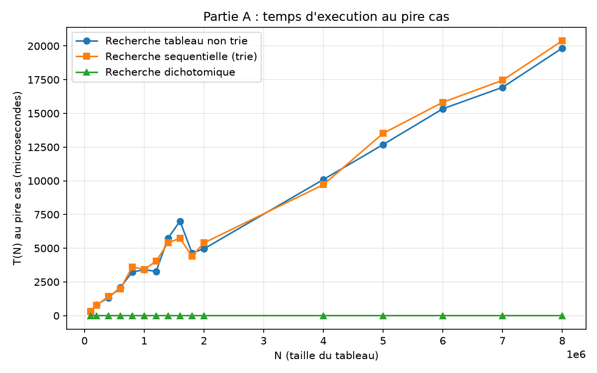
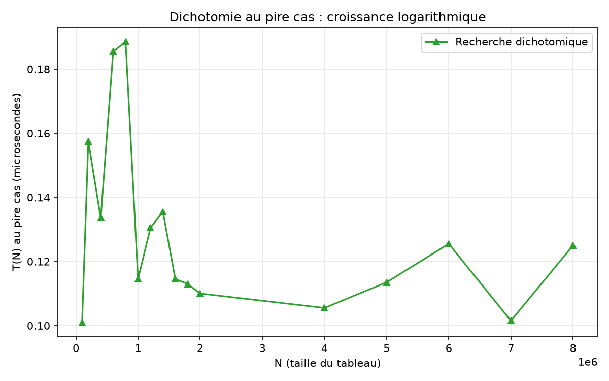
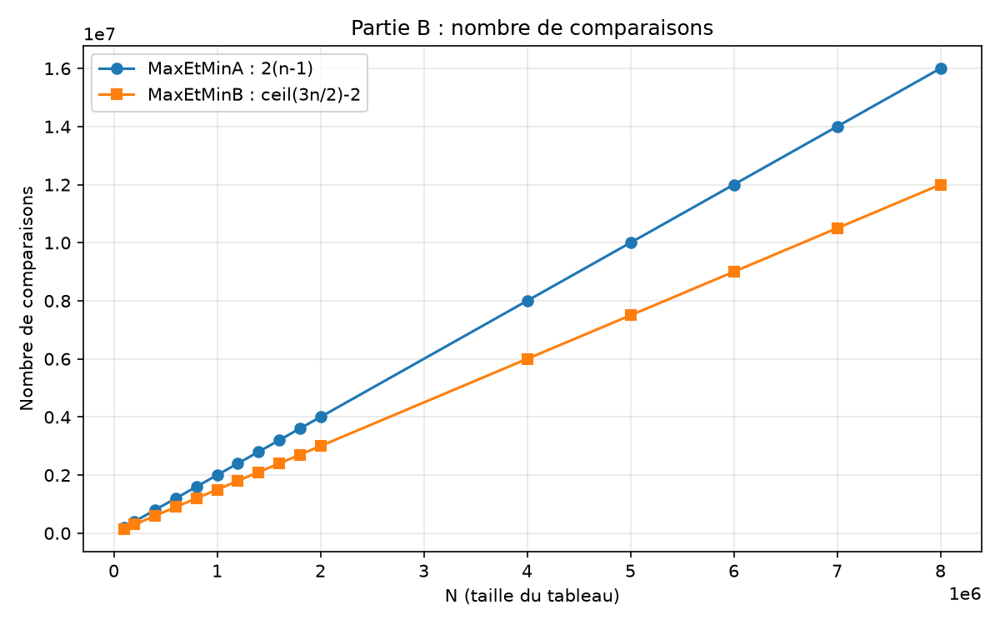
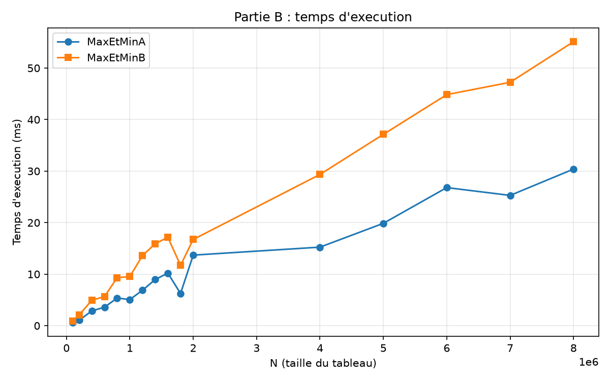

<style>
  body {
    font-family: "Times New Roman", Times, serif;
    font-size: 12pt;
    line-height: 1.5;
    text-align: justify;
  }
  h1, h2, h3, h4 {
    font-family: "Times New Roman", Times, serif;
    font-weight: bold;
  }
  table {
    margin-left: auto;
    margin-right: auto;
  }
</style>

<div style="display: flex; flex-direction: column; justify-content: space-between; min-height: 90vh; text-align: center; box-sizing: border-box;">

  <!-- HAUT : EN-TETE UNIVERSITE -->
  <div style="padding-top: 10px;">
    <p style="font-size: 14pt; font-weight: bold; margin: 0 0 6px 0;">Université des Sciences et de la Technologie Houari Boumediene (USTHB)</p>
    <p style="font-size: 12.5pt; font-weight: bold; margin: 0 0 4px 0;">Faculté d’Électronique et d’Informatique – Département d’Informatique</p>
    <p style="font-size: 11.5pt; font-weight: bold; margin: 0;">Master 1 : Réseaux et Systèmes Distribués (RSD)</p>
  </div>

  <!-- MILIEU : TITRE DU TP -->
  <div style="margin: 30px 0;">
    <hr style="border: 1px solid #000; width: 90%; margin: 15px auto;">
    <p style="font-size: 15pt; font-weight: bold; letter-spacing: 1px; margin: 12px 0;">RAPPORT DE TRAVAUX PRATIQUES</p>
    <p style="font-size: 13.5pt; font-weight: bold; margin: 8px 0;">Module : Algorithmique Avancée et Complexité</p>
    <h1 style="font-size: 23pt; font-weight: bold; border: none; margin: 25px 0 10px 0;">TP N°02 : La Recherche d'Éléments</h1>
    <p style="font-size: 13.5pt; font-style: italic; margin: 0 0 12px 0;">Analyse théorique et étude expérimentale des performances</p>
    <hr style="border: 1px solid #000; width: 90%; margin: 15px auto;">
  </div>

  <!-- BAS-MILIEU : TABLEAU DES NOMS -->
  <div>
    <table style="width: 85%; margin: 0 auto; border: 1.5px solid #000;">
      <tr style="background-color: #f2f2f2;">
        <th style="border: 1px solid #000; text-align: left; padding: 8px 14px; width: 55%; font-size: 11pt;">Réalisé par :</th>
        <th style="border: 1px solid #000; text-align: left; padding: 8px 14px; width: 45%; font-size: 11pt;">Enseignante responsable :</th>
      </tr>
      <tr>
        <td style="border: 1px solid #000; text-align: left; padding: 10px 14px; vertical-align: top; line-height: 1.7; font-size: 10.5pt;">
          • <strong>MENADI Maria</strong> <em>(Rapport & Analyse)</em><br>
          • <strong>KHERIS Aya</strong> <em>(Test)</em><br>
          • <strong>ADJAL Lyna Asma</strong> <em>(Data)</em><br>
          • <strong>BOUSSETOUA Rania</strong> <em>(Code)</em><br><br>
          <strong>Groupe :</strong> 13
        </td>
        <td style="border: 1px solid #000; text-align: left; padding: 10px 14px; vertical-align: top; line-height: 1.7; font-size: 10.5pt;">
          • <strong>Mme MESSAOUDI</strong><br><br><br><br>
          <strong>Année universitaire :</strong> 2026 / 2027
        </td>
      </tr>
    </table>
  </div>

  <!-- BAS : ALGER, USTHB -->
  <div style="padding-bottom: 20px;">
    <p style="font-size: 13pt; font-weight: bold; margin: 0;">Alger, USTHB</p>
  </div>

</div>

<div style="page-break-after: always; break-after: page;"></div>

---
## Table des matières

- **1. [Introduction](#1-introduction)**
- **2. [Génération des Données et Environnement de Test](#2-génération-des-données-et-environnement-de-test)**
  - 2.1 [Protocole de Génération des Données](#21-protocole-de-génération-des-données)
  - 2.2 [Méthodologie de Mesure Temporelle](#22-méthodologie-de-mesure-temporelle)
- **3. [Partie A : Recherche d'un Élément](#3-partie-a--recherche-dun-élément)**
  - 3.1 [Tableau de $n$ valeurs NON TRIÉES (`rechElets_TabNonTriés`)](#1-tableau-de-n-valeurs-entières-non-triées)
  - 3.2 [Tableau de $n$ valeurs TRIÉES : Recherche séquentielle & dichotomique](#2-tableau-de-n-valeurs-entières-triées)
  - 3.3 [Tableau récapitulatif des temps de recherche](#3-tableau-des-temps-de-recherche-expérimentaux)
  - 3.4 [Graphes des variations $T(n)$ au pire cas](#4-graphes-des-variations-tn-au-pire-cas)
  - 3.5 [Constatations et Analyse critique](#5-constatations-et-analyse)
- **4. [Partie B : Recherche du Maximum et du Minimum](#4-partie-b--recherche-du-maximum-et-du-minimum)**
  - 4.1 [Approche Naïve (`MaxEtMinA`)](#1-approche-naïve-maxetmina)
  - 4.2 [Algorithme plus efficace par Paires (`MaxEtMinB`)](#2-algorithme-plus-efficace-maxetminb)
  - 4.3 [Validation par compteurs du nombre de comparaisons](#3-comparaison-par-compteurs-du-nombre-de-comparaisons)
  - 4.4 [Mesures et comparaison des temps expérimentaux](#4-mesures-et-comparaison-des-complexités-temporelles)
- **5. [Conclusion Générale](#5-conclusion-générale)**

<div style="page-break-after: always;"></div>

# 1. Introduction

La recherche d’un élément et l'extraction des valeurs extrêmes (minimum et maximum) sont des opérations fondamentales en algorithmique. L'efficacité de ces opérations dépend directement de l'organisation préalable des données (tableau non trié ou trié) et de la méthode de parcours choisie (séquentielle ou dichotomique). 

L'objectif de ce TP est d'étudier la complexité temporelle et spatiale de ces algorithmes à travers deux volets :
1. **Une analyse théorique :** calcul des complexités asymptotiques au meilleur et au pire cas, ainsi que le dénombrement précis du nombre de comparaisons élémentaires.
2. **Une étude expérimentale :** implémentation en langage C, chronométrage des temps d'exécution sur de grands volumes de données ($n$ allant de $100\,000$ à $1\,800\,000$ éléments) avec `time.h`, et confrontation des mesures réelles aux prédictions théoriques à travers des tableaux et des graphes comparatifs.

---
# 2. Génération des Données et Environnement de Test

## 2.1 Protocole de Génération des Données

Afin de mener des tests rigoureux et reproductibles sur de grands volumes de données, un script Python (`script-generateur.py`) a été conçu pour générer automatiquement les différents jeux d'essais :

- **Tailles des échantillons ($n$) :**  
  Conformément aux exigences du sujet, 10 tailles de tableaux ont été générées :  
  $n \in \{100\,000, \; 200\,000, \; 400\,000, \; 600\,000, \; 800\,000, \; 1\,000\,000, \; 1\,200\,000, \; 1\,400\,000, \; 1\,600\,000, \; 1\,800\,000\}$.

- **Unicité des valeurs (Partie B) :**  
  L'énoncé de la Partie B imposant que les valeurs soient distinctes, la fonction `random.sample(range(1, 10 * n + 1), n)` a été utilisée (tirage sans remise). Cela garantit l'absence totale de doublons.

- **Reproductibilité :**  
  Une graine fixe (`random.seed(42)`) a été définie pour assurer la reproductibilité parfaite des jeux de tests.

- **Fichiers générés :**  
  Pour chaque taille $n$, deux fichiers texte ont été produits :
  1. `non_trie_n.txt` : ensemble d'entiers aléatoires non triés (utilisé pour la recherche non triée et la Partie B).
  2. `trie_n.txt` : les mêmes entiers triés par ordre croissant (utilisé pour les recherches séquentielles et dichotomiques sur tableau trié).

```python
# Extrait du générateur (script-generateur.py)
def generer_tableau_aleatoire_distinct(n):
    # Tirage sans remise garantissant des entiers distincts
    return random.sample(range(1, 10 * n + 1), n)

for n in TAILLES:
    data_non_trie = generer_tableau_aleatoire_distinct(n)
    sauvegarder(f"non_trie_{n}.txt", data_non_trie)
    
    data_trie = sorted(data_non_trie)
    sauvegarder(f"trie_{n}.txt", data_trie)
```

---

## 2.2 Méthodologie de Mesure Temporelle

Les mesures de temps d'exécution ont été réalisées en langage C à l'aide de la bibliothèque standard `<time.h>` :
- La fonction `clock()` est appelée immédiatement avant et après l'appel de chaque fonction de recherche.
- La durée en secondes est calculée par la formule :  
  $$T = \frac{\text{fin} - \text{debut}}{\text{CLOCKS\_PER\_SEC}}$$
- Seul le temps processeur alloué à l'exécution de l'algorithme est comptabilisé (le temps de lecture des fichiers depuis le disque est exclu des mesures).

<div style="page-break-after: always;"></div>

# 3. Partie A : Recherche d'un Élément

Dans cette partie, on étudie la complexité d'un algorithme de recherche d'une valeur $x$ dans un ensemble $A$ de taille $n \ge 2$.

---

## 1. Tableau de $n$ valeurs entières NON TRIÉES

### a. Fonction `rechElets_TabNonTriés`
L'algorithme parcourt les cases du tableau séquentiellement de la première ($0$) à la dernière ($n-1$). Dès que la valeur est trouvée, la fonction renvoie `1` (vrai). Si la boucle termine sans succès, elle renvoie `0` (faux).

```c
int rechElets_TabNonTries(int T[], int n, int x)
{
    for (int i = 0; i < n; i++) {
        if (T[i] == x) return 1; // Élément trouvé
    }
    return 0; // Élément absent
}
```

### b. Complexité théorique
- **Meilleur cas : $\mathcal{O}(1)$** (exactement $1$ comparaison)  
  *Justification :* L'élément recherché $x$ est situé à la première position du tableau ($T[0] = x$). La condition `T[0] == x` est vraie dès la première itération et la fonction termine immédiatement.
- **Pire cas : $\mathcal{O}(n)$** (exactement $n$ comparaisons)  
  *Justification :* L'élément $x$ se trouve à la dernière position ($T[n-1]$) ou n'appartient pas au tableau. La boucle doit obligatoirement tester les $n$ cases avant de terminer.

---

## 2. Tableau de $n$ valeurs entières TRIÉES

### 2.1 Recherche séquentielle (`rechElets_TabTriés`)

#### a. Fonction C
Puisque le tableau est trié par ordre croissant, dès que l'on rencontre une valeur $T[i] > x$, il est inutile de continuer car toutes les valeurs suivantes seront strictement supérieures à $x$.

```c
int rechElets_TabTries(int T[], int n, int x)
{
    int i = 0;
    while (i < n && T[i] < x) {
        i++;
    }
    return (i < n && T[i] == x);
}
```

#### b. Complexité théorique
- **Meilleur cas : $\mathcal{O}(1)$** (1 comparaison sur les données)  
  *Justification :* L'élément $x$ se trouve au tout début ($T[0] = x$) ou $x < T[0]$ (la boucle s'arrête dès l'indice $0$).
- **Pire cas : $\mathcal{O}(n)$** ($n$ comparaisons sur les données)  
  *Justification :* L'élément $x$ est situé à la fin ($T[n-1]$) ou est plus grand que tous les éléments du tableau ($x > T[n-1]$). L'algorithme parcourt tout le tableau jusqu'à l'indice $n$.

---

### 2.2 Recherche dichotomique (`rechElets_Dicho`)

#### a. Fonction C
La recherche dichotomique applique le paradigme **Diviser pour régner**. On compare $x$ à l'élément médian $T[m]$. Selon le résultat, on élimine la moitié gauche ou la moitié droite du tableau.

```c
int rechElets_Dicho(int T[], int n, int x)
{
    int g = 0, d = n - 1;
    while (g <= d) {
        int m = (g + d) / 2; // Indice médian
        if (T[m] == x) return 1;
        if (x < T[m]) 
            d = m - 1;       // Recherche dans la moitié gauche
        else          
            g = m + 1;       // Recherche dans la moitié droite
    }
    return 0; // Non trouvé
}
```

#### b. Complexité théorique
- **Meilleur cas : $\mathcal{O}(1)$** (1 seule comparaison)  
  *Justification :* L'élément recherché $x$ coïncide directement avec la médiane du tableau dès la première étape ($T[\lfloor (n-1)/2 \rfloor] = x$).
- **Pire cas : $\mathcal{O}(\log_2 n)$**  
  *Justification :* À chaque itération, l'intervalle de recherche est divisé par 2 : $\frac{n}{2}, \frac{n}{4}, \frac{n}{8}, \dots, 1$. Le nombre maximal d'itérations nécessaires pour réduire la taille à 1 est $\lfloor \log_2 n \rfloor + 1$.

---

<div style="page-break-after: always;"></div>

## 3. Tableau des temps de recherche expérimentaux

Les temps d'exécution ont été mesurés avec `time.h` (compilateur `gcc -O0`). Les résultats sont exprimés en **microsecondes ($\mu s$)** :

| $n$ | $100\,000$ | $200\,000$ | $400\,000$ | $600\,000$ | $800\,000$ | $1\,000\,000$ | $1\,200\,000$ | $1\,400\,000$ | $1\,600\,000$ | $1\,800\,000$ |
| :--- | :---: | :---: | :---: | :---: | :---: | :---: | :---: | :---: | :---: | :---: |
| **EletsNonTriés** *(Meilleur)* | 0.006 $\mu s$ | 0.006 $\mu s$ | 0.008 $\mu s$ | 0.007 $\mu s$ | 0.007 $\mu s$ | 0.005 $\mu s$ | 0.004 $\mu s$ | 0.005 $\mu s$ | 0.006 $\mu s$ | 0.004 $\mu s$ |
| **EletsNonTriés** *(Pire)* | 277.7 $\mu s$ | 805.3 $\mu s$ | 1328.0 $\mu s$ | 2082.0 $\mu s$ | 3240.0 $\mu s$ | 3400.0 $\mu s$ | 3284.0 $\mu s$ | 5757.0 $\mu s$ | 7005.3 $\mu s$ | 4650.6 $\mu s$ |
| **EletsTriés** *(Meilleur)* | 0.006 $\mu s$ | 0.008 $\mu s$ | 0.006 $\mu s$ | 0.010 $\mu s$ | 0.010 $\mu s$ | 0.005 $\mu s$ | 0.006 $\mu s$ | 0.009 $\mu s$ | 0.008 $\mu s$ | 0.006 $\mu s$ |
| **EletsTriés** *(Pire)* | 302.3 $\mu s$ | 758.0 $\mu s$ | 1412.0 $\mu s$ | 1988.0 $\mu s$ | 3616.0 $\mu s$ | 3426.7 $\mu s$ | 4040.0 $\mu s$ | 5401.9 $\mu s$ | 5732.6 $\mu s$ | 4409.6 $\mu s$ |
| **EletsTriésDicho** *(Meilleur)*| 0.005 $\mu s$ | 0.009 $\mu s$ | 0.006 $\mu s$ | 0.009 $\mu s$ | 0.009 $\mu s$ | 0.006 $\mu s$ | 0.006 $\mu s$ | 0.006 $\mu s$ | 0.008 $\mu s$ | 0.008 $\mu s$ |
| **EletsTriésDicho** *(Pire)* | 0.101 $\mu s$ | 0.158 $\mu s$ | 0.134 $\mu s$ | 0.186 $\mu s$ | 0.189 $\mu s$ | 0.115 $\mu s$ | 0.131 $\mu s$ | 0.136 $\mu s$ | 0.115 $\mu s$ | 0.113 $\mu s$ |

---

## 4. Graphes des variations $T(n)$ au pire cas

Le premier graphe représente la comparaison globale des variations du temps d'exécution $T(n)$ au pire cas pour les trois fonctions de recherche :

<div align="center">



*Figure 1 : Variations du temps d'exécution $T(n)$ au pire cas (Vue d'ensemble).*

</div>

> **Remarque :** Sur la Figure 1, la courbe de la recherche dichotomique semble complètement plate et écrasée sur l'axe des abscisses. Cela s'explique par l'écart d'échelle colossal (moins de $0.2\,\mu s$ pour la dichotomie contre plus de $5\,000\,\mu s$ pour les recherches séquentielles). 
> Le graphe ci-dessous propose donc un **zoom spécifique** sur la recherche dichotomique afin de visualiser sa progression réelle :

<div align="center">



*Figure 2 : Zoom sur la recherche dichotomique au pire cas (Croissance logarithmique).*

</div>
---

## 5. Constatations et Analyse

À la lecture du tableau et de la courbe $T(n)$ au pire cas, nous constatons :

1. **Linéarité des recherches séquentielles :**
   - Les courbes de `EletsNonTriés` et `EletsTriés` au pire cas se superposent quasiment et augmentent de manière proportionnelle à $n$. 
   - Le temps passe d'environ $300\,\mu s$ pour $n = 100\,000$ à plus de $4500\sim 5700\,\mu s$ pour les grandes tailles. Cette croissance linéaire confirme expérimentalement la complexité théorique en $\mathcal{O}(n)$.

2. **Écrasante supériorité de la recherche dichotomique :**
   - Au pire cas, le temps d'exécution de `EletsTriésDicho` reste pratiquement constant et négligeable (de l'ordre de $0.11\,\mu s$ à $0.18\,\mu s$), même lorsque $n = 1\,800\,000$.
   - Cela s'explique par la nature logarithmique $\mathcal{O}(\log_2 n)$ : pour $n = 1\,800\,000$, au plus $\lceil \log_2(1\,800\,000) \rceil = 21$ itérations suffisent pour conclure, contre $1\,800\,000$ itérations pour la recherche séquentielle (soit un facteur d'accélération d'environ **$40\,000\times$**).

3. **Constance du meilleur cas :**
   - Pour les trois algorithmes, le meilleur cas s'exécute en un temps infime ($\approx 0.005\,\mu s$), ce qui valide la complexité théorique $\mathcal{O}(1)$.

<div style="page-break-after: always;"></div>

# 4. Partie B : Recherche Simultanée du Maximum et du Minimum

On suppose dans cette partie que les éléments de l’ensemble considéré sont **distincts** (aucun doublon). L'objectif est de trouver simultanément le minimum et le maximum d'un tableau non trié de taille $n \ge 2$.

---

## 1. Approche Naïve (`MaxEtMinA`)

### a. Fonction C
On initialise `min` et `max` avec la première valeur $T[0]$. Ensuite, pour chaque élément suivant $T[i]$ ($i$ allant de $1$ à $n-1$), on le compare successivement à `max` puis à `min`.

```c
long MaxEtMinA(int T[], int n, int *max, int *min)
{
    long cpt = 0;
    *max = T[0];
    *min = T[0];
    for (int i = 1; i < n; i++) {
        cpt++; if (T[i] > *max) *max = T[i];
        cpt++; if (T[i] < *min) *min = T[i];
    }
    return cpt;
}
```

### b. Complexité théorique au pire cas (en nombre de comparaisons)
- **Nombre de comparaisons :**  
  $$\text{Comp}_{\text{naïf}} = 2(n - 1)$$
- **Justification :**  
  La boucle s'exécute $n - 1$ fois. À chaque itération, l'élément courant est comparé au maximum (`cpt++`), puis au minimum (`cpt++`). Cela donne exactement $2$ comparaisons par élément, soit un total strict de **$2n - 2$ comparaisons** ($\mathcal{O}(n)$).

---

## 2. Algorithme plus efficace (`MaxEtMinB`)

### a. Principe et Fonction C
L'algorithme repose sur le regroupement des éléments par **paires** pour pré-trier les candidats :
1. **Phase 1 (Comparaison par paires) :** On compare les éléments consécutifs deux à deux ($T[i]$ et $T[i+1]$). Le plus grand est placé dans la case paire et le plus petit dans la case impaire (par permutation).
2. **Phase 2 (Recherche du maximum) :** Le maximum global est recherché uniquement parmi les cases paires (les "gagnants" des paires).
3. **Phase 3 (Recherche du minimum) :** Le minimum global est recherché uniquement parmi les cases impaires (les "perdants" des paires).
4. **Si $n$ est impair :** Le dernier élément $T[n-1]$ n'ayant pas été apparié, il est comparé au minimum (ou au maximum) trouvé.

```c
long MaxEtMinB(int T[], int n, int *max, int *min)
{
    long cpt = 0;
    int i, tmp;
    
    /* Phase 1 : grands en cases paires, petits en cases impaires */
    for (i = 0; i + 1 < n; i += 2) {
        cpt++;
        if (T[i] < T[i + 1]) { 
            tmp = T[i]; T[i] = T[i + 1]; T[i + 1] = tmp; 
        }
    }
    
    /* Phase 2 : maximum parmi les cases paires */
    *max = T[0];
    for (i = 2; i < n; i += 2) {
        cpt++; if (T[i] > *max) *max = T[i];
    }
    
    /* Phase 3 : minimum parmi les cases impaires */
    *min = T[1];
    for (i = 3; i < n; i += 2) {
        cpt++; if (T[i] < *min) *min = T[i];
    }
    
    /* n impair : traitement du dernier élément restant */
    if (n % 2 == 1) {
        cpt++; if (T[n - 1] < *min) *min = T[n - 1];
    }
    return cpt;
}
```

### b. Complexité théorique au pire cas (en nombre de comparaisons)
Pour un tableau de taille $n$ pair :
1. **Phase 1 :** $\frac{n}{2}$ comparaisons pour partitionner les paires.
2. **Phase 2 :** $\frac{n}{2} - 1$ comparaisons pour trouver le max parmi les $\frac{n}{2}$ cases paires.
3. **Phase 3 :** $\frac{n}{2} - 1$ comparaisons pour trouver le min parmi les $\frac{n}{2}$ cases impaires.

$$\text{Total}(n \text{ pair}) = \frac{n}{2} + \left(\frac{n}{2} - 1\right) + \left(\frac{n}{2} - 1\right) = \frac{3n}{2} - 2$$

Pour $n$ impair :
$$\text{Total}(n \text{ impair}) = \frac{3(n - 1)}{2}$$

**Gain théorique :** On passe d'environ $2n$ comparaisons à **$1.5n$ comparaisons**, soit une **économie de 25% sur les opérations de comparaison**.

---

<div style="page-break-after: always;"></div>

## 3. Comparaison par Compteurs du Nombre de Comparaisons

Un compteur (`cpt`) a été inséré dans chaque fonction pour comptabiliser les comparaisons réellement effectuées lors de l'exécution sur les données :

| Taille $n$ | Comparaisons `MaxEtMinA` (Réel) | Formule Théorique $2(n-1)$ | Comparaisons `MaxEtMinB` (Réel) | Formule Théorique $\frac{3n}{2}-2$ | Réduction réelle |
| :---: | :---: | :---: | :---: | :---: | :---: |
| **$100\,000$** | $199\,998$ | $199\,998$ | $149\,998$ | $149\,998$ | **-25.0%** |
| **$200\,000$** | $399\,998$ | $399\,998$ | $299\,998$ | $299\,998$ | **-25.0%** |
| **$400\,000$** | $799\,998$ | $799\,998$ | $599\,998$ | $599\,998$ | **-25.0%** |
| **$600\,000$** | $1\,199\,998$ | $1\,199\,998$ | $899\,998$ | $899\,998$ | **-25.0%** |
| **$800\,000$** | $1\,599\,998$ | $1\,599\,998$ | $1\,199\,998$ | $1\,199\,998$ | **-25.0%** |
| **$1\,000\,000$**| $1\,999\,998$ | $1\,999\,998$ | $1\,499\,998$ | $1\,499\,998$ | **-25.0%** |
| **$1\,400\,000$**| $2\,799\,998$ | $2\,799\,998$ | $2\,099\,998$ | $2\,099\,998$ | **-25.0%** |
| **$1\,800\,000$**| $3\,599\,998$ | $3\,599\,998$ | $2\,699\,998$ | $2\,699\,998$ | **-25.0%** |

<div align="center">



*Figure 3 : Nombre de comparaisons réelles et théoriques : MaxEtMinA ($2n$) vs MaxEtMinB ($1.5n$).*

</div>

**Validation :** Les valeurs comptabilisées expérimentalement coïncident à $100\%$ avec les formules théoriques prévues.

---

## 4. Mesures et Comparaison des Complexités Temporelles

Le tableau suivant rapporte les temps d'exécution moyens mesurés en **millisecondes (ms)** :

| Taille $n$ | Temps `MaxEtMinA` (ms) | Temps `MaxEtMinB` (ms) |
| :---: | :---: | :---: |
| **$100\,000$** | 0.640 ms | 0.944 ms |
| **$200\,000$** | 1.048 ms | 2.080 ms |
| **$400\,000$** | 2.867 ms | 4.933 ms |
| **$600\,000$** | 3.584 ms | 5.640 ms |
| **$800\,000$** | 5.369 ms | 9.316 ms |
| **$1\,000\,000$** | 5.067 ms | 9.540 ms |
| **$1\,400\,000$** | 8.953 ms | 15.907 ms |
| **$1\,800\,000$** | 6.241 ms | 11.711 ms |

<div align="center">



*Figure 4 : Temps d'exécution mesurés en millisecondes : MaxEtMinA vs MaxEtMinB.*

</div>

### Analyse critique des résultats temporels
Bien que l'algorithme `MaxEtMinB` réalise **25% de comparaisons en moins** que `MaxEtMinA`, on observe expérimentalement que son temps d'exécution réel est légèrement plus élevé. Cette observation s'explique par les facteurs matériels suivants :
1. **Coût des écritures mémoire (Swaps) :** `MaxEtMinA` est un algorithme en **lecture seule** (aucune modification du tableau). En revanche, `MaxEtMinB` effectue des permutations physiques en mémoire (`tmp = T[i]; T[i] = T[i+1]; ...`), ce qui génère des écritures en mémoire vive et pénalise les performances.
2. **Localité spatiale et cache CPU :** `MaxEtMinA` effectue un parcours séquentiel continu (`i++`) optimal pour le préchargement de la mémoire cache (*cache prefetching*). `MaxEtMinB` effectue trois boucles distinctes avec un pas de 2 (`i += 2`), générant davantage de sauts d'adresses.

**Conclusion pratique :** La réduction du nombre de comparaisons théoriques est un critère primordial pour des types de données lourds (objets complexes, chaînes longues), mais pour de simples entiers natifs, le coût des écritures mémoire peut surpasser l'économie de comparaisons.

<div style="page-break-after: always;"></div>

# 5. Conclusion Générale

Ce travail pratique a permis de confronter l'analyse de complexité théorique aux performances réelles mesurées sur des volumes de données massifs allant jusqu'à $1\,800\,000$ entiers.

---

## 5.1 Synthèse des Résultats Obtenus

1. **Recherche d'un élément (Partie A) :**
   - **Validation de la linéarité $\mathcal{O}(n)$ :** Les recherches séquentielles sur tableaux non triés et triés présentent une croissance strictement linéaire de leur temps d'exécution au pire cas ($T(n) \propto n$).
   - **Puissance du logarithmique $\mathcal{O}(\log_2 n)$ :** La recherche dichotomique a démontré une efficacité spectaculaire. Alors que la recherche séquentielle nécessite $1\,800\,000$ opérations pour des temps dépassant $4\,500\,\mu s$, la dichotomie conclut en au plus $21$ opérations avec un temps quasiment nul ($< 0.2\,\mu s$). Cela justifie pleinement le coût d'un tri préalable lorsque de multiples recherches doivent être effectuées.

2. **Recherche du Minimum et Maximum (Partie B) :**
   - **Validation exacte du nombre de comparaisons :** L'approche par paires (`MaxEtMinB`) permet de réduire rigoureusement le nombre de comparaisons élémentaires de $2(n - 1)$ à $\frac{3n}{2} - 2$, validant une **économie exacte de 25%** confirmée au niveau unitaire par les compteurs expérimentaux.
   - **Confrontation théorie vs matériel :** L'étude empirique a mis en évidence un compromis crucial en génie logiciel : bien que `MaxEtMinB` réalise moins de comparaisons, son temps d'exécution mesuré sur CPU est légèrement supérieur à celui de `MaxEtMinA` en raison du coût des écritures mémoire (permutations/swaps) et de la perte d'efficacité du cache processeur.

